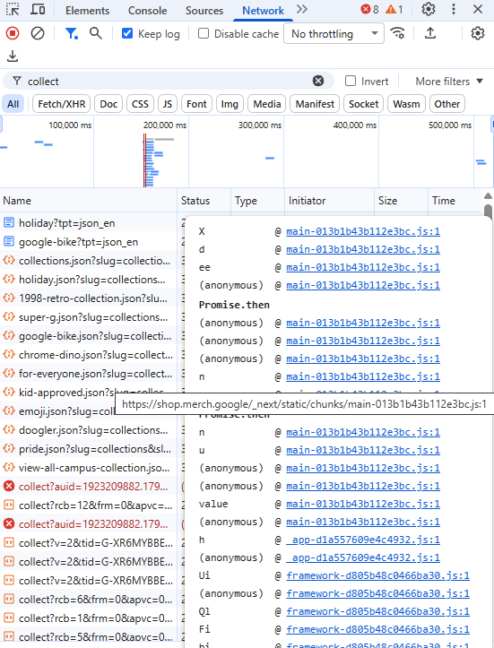
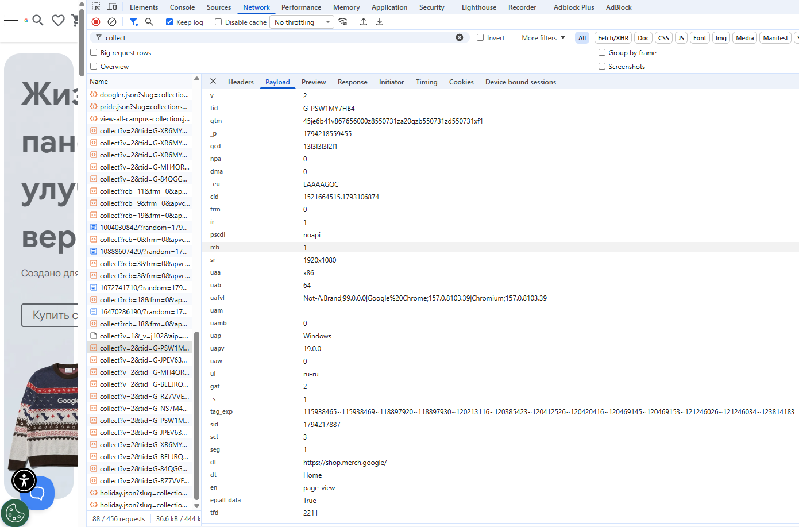

# Домашняя работа № 1 · Путь данных от ссылки до заявки

**Дисциплина:** ОП.03 «Информационные технологии»

| Поле | Значение |
|---|---|
| Фамилия, имя, отчество | Коковашин Тимур Александрович |
| Группа | 11/1-РПО-26/1 |
| Номер работы | 1 |
| Тема работы | Цифровая воронка: путь данных от ссылки до заявки |
| Дата сдачи | 09.11.2026 |

---

## Задание

1. Открыть сайт, панель разработчика (F12) → **Network**, в фильтре `collect`,
   галочка **Preserve log**.
2. Сделать три действия: обновить страницу, прокрутить до низа, нажать
   на товар. Записать, какие события ушли — параметр `en` на вкладке **Payload**.
3. Описать путь пользователя от ссылки до заявки, пять шагов.
4. Найти одно место на этом пути, где данные могут потеряться.
5. Приложить скриншоты `screens/01-network.png` и `screens/02-payload.png`.

Сайт: https://shop.merch.google/, запасные — https://habr.com/ru/,
https://www.smashingmagazine.com/, https://css-tricks.com/. Открывать
в Chrome или Edge с выключенным блокировщиком рекламы.

Срок — до начала занятия 2. Работа сдаётся коммитом в `main`.

---

## 1. Какой сайт смотрел

| Поле | Значение |
|---|---|
| Название сайта | Google Merchandise Store (Google Merch Shop) |
| Адрес | https://shop.merch.google/ |
| Откуда сайт | из списка в задании |

## 2. Три действия и что отправил счётчик

Панель Network, фильтр `collect`, галочка Preserve log. Название события
лежит в параметре `en` на вкладке Payload.

В первой строке стоит пример. **Удалите его** и впишите свои три.

| № | Что я сделал на сайте | Название события (`en`) | Что ещё было в Payload |
|---|---|---|---|
| 1 | обновил страницу | `page_view` (у одного из счётчиков ещё `view_promotion` — показ баннеров) | `dl=https://shop.merch.google/`, `dt=Home`, `tid` — ID счётчика (`G-PSW1MY7HB4` и ещё несколько), `cid` — ID посетителя, `sid` — ID сеанса, `ul=ru-ru`, `sr=1920x1080` |
| 2 | прокрутил до низа | `scroll` | `epn.percent_scrolled=90` — долистал до 90 % страницы, `dl` — та же главная, `_et` — время на странице до события |
| 3 | нажал на «Shop Headgear», затем на товар Google Navy Bike Cap | `select_promotion` → `page_view` → `select_item` → `view_item` | `dl=…/product/apparel/headgear/google-navy-bike-cap-ggoeghpl236399?itemListName=Category`, `dr=https://shop.merch.google/shop/apparel/headgear` — страница, откуда пришёл, `pr1` — данные товара, `ep.item_list_name=Category` |

Скриншоты:

## 3. Путь пользователя: 5 шагов

От ссылки до заявки, своими словами. Панель для этого не нужна: это рассказ
о том, как человек доходит до кнопки «Отправить». В правом столбце стоит
пример, в левом вы пишете свой вариант.

| № | Мой шаг | Пример |
|---|---|---|
| 1 | человек увидел в Telegram-канале пост со ссылкой на магазин мерча Google и нажал на неё | *человек увидел ссылку в сообществе и нажал на неё* |
| 2 | открылась главная страница магазина, сверху баннеры с акциями | *открылась главная страница сайта* |
| 3 | он прокрутил главную вниз до блока категорий и нажал «Shop Headgear» | *он прокрутил до формы записи* |
| 4 | в каталоге выбрал Google Navy Bike Cap, открыл карточку и нажал «Добавить в корзину» | *начал заполнять: имя и телефон* |
| 5 | перешёл в корзину, заполнил имя, телефон и адрес и нажал «Оформить заказ» — заявка ушла менеджеру | *нажал «Отправить», заявка ушла менеджеру* |

## 4. Где данные могут потеряться

В первой строке стоит пример, **удалите его**. Строку 1 заполняют все,
строку 2 заполняйте по желанию.

| № | На каком шаге | Что может потеряться |
|---|---|---|
| 1 | шаг 2, открытие главной страницы | при первом заходе всплывает баннер cookies. Если человек нажмёт «Reject All» или закроет сайт, не ответив, счётчики работают в режиме без согласия (в Payload это видно по параметрам `gcs` и `npa`): часть данных о визите и источнике перехода в отчёты не попадёт |
| 2 | шаг 5, отправка заявки | если человек закроет вкладку сразу после нажатия «Отправить» или сработает блокировщик рекламы, событие о заявке не дойдёт до счётчика, и в отчёте заявок будет меньше, чем пришло менеджеру |

## 5. Использование ИИ

| Вопрос | Ответ |
|---|---|
| Что сделал сам |  |
| Что спросил у модели |  |
| Что после этого изменил |  |
