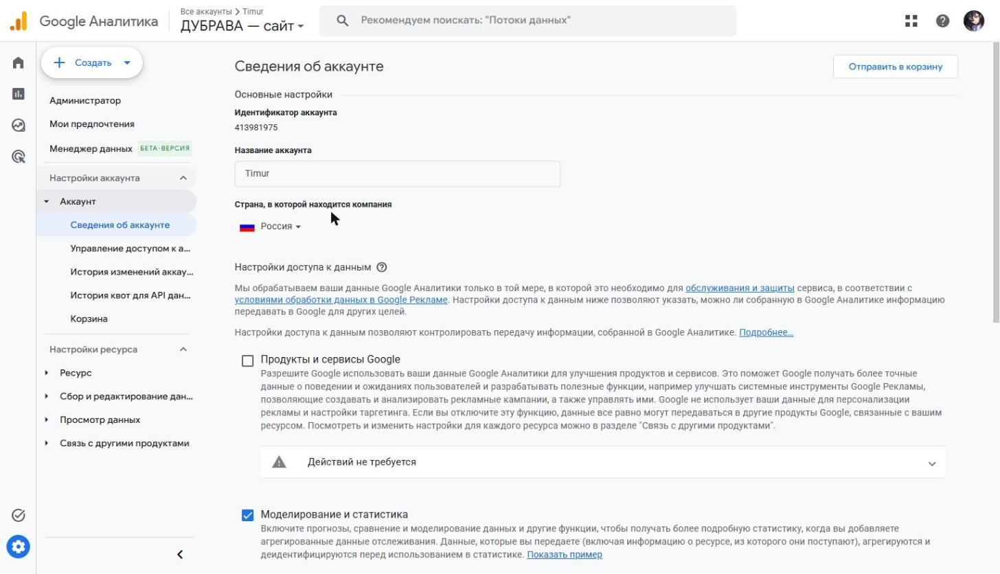
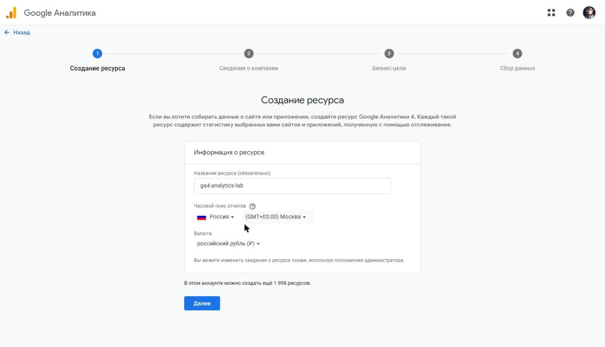
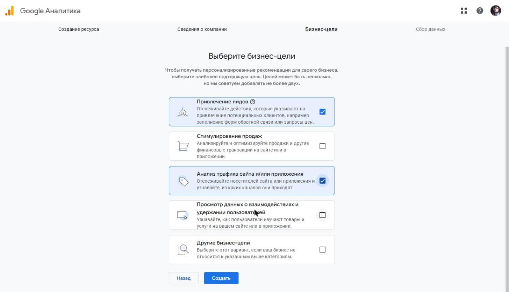
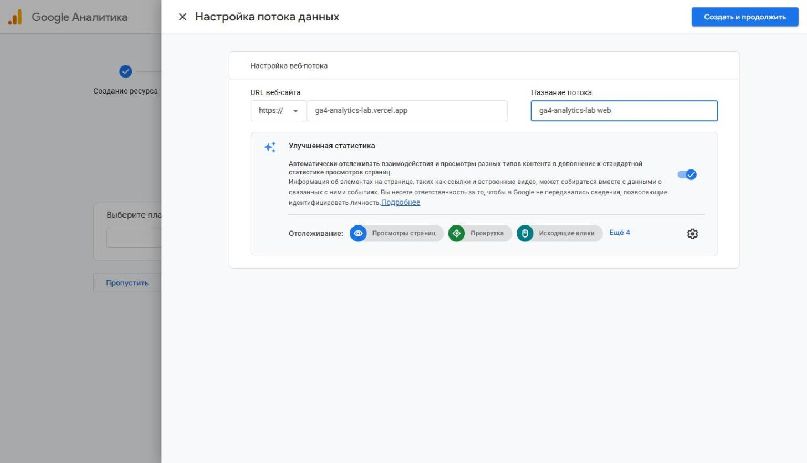
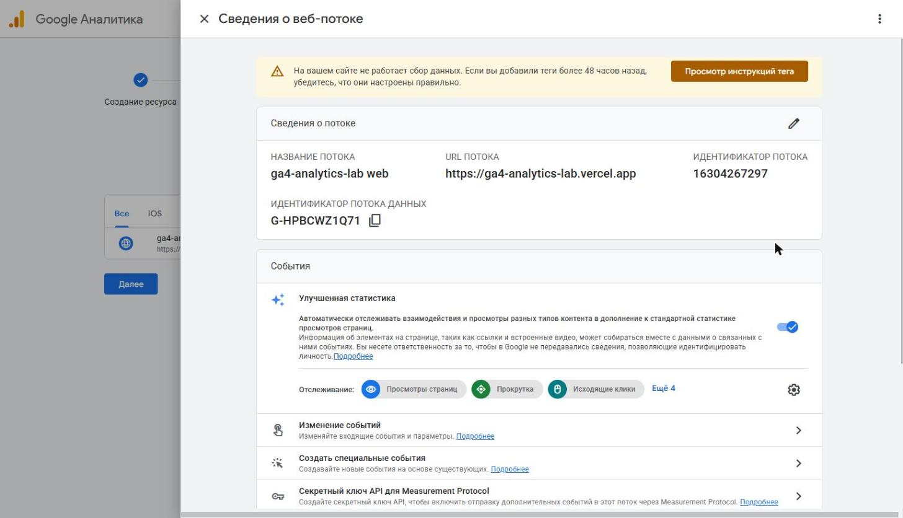

# Домашняя работа № 2 · Где бизнес теряет клиентов

**Дисциплина:** ОП.03 «Информационные технологии»

| Поле | Значение |
|---|---|
| Фамилия, имя, отчество | Коковашин Тимур Александрович |
| Группа | 11/1-РПО-26/1 |
| Номер работы | 2 |
| Тема работы | Анализ воронки цифрового продукта и структура Google Analytics 4 |
| Дата сдачи | 09.11.2026 |

---

# Часть 1. Исследование воронки

## 1.1. Объект исследования

| Поле | Значение |
|---|---|
| Компания, сервис или отрасль | российские интернет-магазины одежды и обуви (путь покупателя рассматривал на примере Lamoda) |
| Адрес сайта или приложения | https://www.lamoda.ru/ |
| Целевое действие | оформленный и оплаченный заказ |
| Почему выбран этот объект | по данным RetailCRM за I квартал 2026 года на одежду и обувь приходится 30% всех брошенных корзин, это самая «проблемная» категория. К тому же в ней хорошо видны все этапы: карточка, корзина, доставка, оплата |

## 1.2. Воронка

| № | Этап | Что считается переходом дальше | Метрика этапа |
|---|---|---|---|
| 1 | переход из рекламы, поиска или соцсети на сайт | посетитель открыл страницу каталога или товара | число сеансов по источникам (UTM), показатель отказов |
| 2 | просмотр каталога и поиск | посетитель открыл карточку товара | доля сеансов с просмотром карточки (`view_item`) |
| 3 | изучение карточки товара | товар добавлен в корзину | конверсия карточки в корзину (`add_to_cart` / `view_item`) |
| 4 | корзина | нажата кнопка «Оформить заказ» | конверсия корзины в начало оформления (`begin_checkout` / `add_to_cart`), доля брошенных корзин |
| 5 | оформление: контакты, адрес, способ и срок доставки | выбрана доставка и введены данные | доля дошедших до выбора оплаты (`add_shipping_info`, `add_payment_info`) |
| 6 | оплата | заказ оплачен | конверсия в покупку (`purchase`), доля отказов на шаге оплаты |

## 1.3. Источники

### Источник 1

| Поле | Значение |
|---|---|
| Название материала | RetailCRM: 88% корзин в российских интернет-магазинах остаются брошенными |
| Автор или организация | New Retail, данные платформы RetailCRM |
| Дата публикации | 14.05.2026 |
| Прямая ссылка | https://new-retail.ru/novosti/retail/retailcrm_88_korzin_v_rossiyskikh_internet_magazinakh_ostayutsya_broshennymi/ |

**Выписка из материала** (ключевая мысль, цифра, наблюдение, результат):

> В I квартале 2026 года 88% корзин остались незавершёнными (годом ранее 85%). При этом 46% брошенных корзин в итоге превратились в заказ. Срок между добавлением в корзину и заказом сократился с 7 до 2 дней. Одежда и обувь — 30% брошенных корзин.

**Что подтверждает и как связано с моей воронкой** (своими словами):

> Между этапами 3–4 (корзина) и 6 (оплата) теряется большая часть покупателей. Но почти половина из них возвращается, поэтому корзина — это скорее «отложенное решение», и с ушедшими можно продолжать работать: напоминания, письма, пуши.

**Цифры из источника и этап воронки, к которому относятся:**

> 88% брошенных корзин и 46% возврата — этап 4 «Корзина». 30% брошенных корзин в одежде и обуви — обоснование выбора объекта.

### Источник 2

| Поле | Значение |
|---|---|
| Название материала | Доставка стала главной причиной отказа от покупок в интернете |
| Автор или организация | «Российская газета», Дмитрий Бевза; исследование ИТ-интегратора AWG |
| Дата публикации | 05.08.2026 |
| Прямая ссылка | https://rg.ru/2026/08/05/dostavka-stala-glavnoj-prichinoj-otkaza-ot-pokupok-v-internete.html |

**Выписка из материала:**

> 65% опрошенных назвали главной причиной отказа неподходящие сроки или стоимость доставки. 30% отказываются уже после просмотра карточки, 24% — положив товар в корзину. Обязательная регистрация при оформлении раздражает 42%.

**Что подтверждает и как связано с моей воронкой:**

> Источник показывает, на каких этапах и почему уходят люди: часть уходит с карточки, часть из корзины, а главная причина — доставка, которую покупатель видит только на этапе оформления.

**Цифры из источника и этап воронки:**

> 30% — этап 3 «Карточка товара»; 24% — этап 4 «Корзина»; 65% (доставка) и 42% (регистрация) — этап 5 «Оформление». Размер выборки в статье не указан.

### Источник 3

| Поле | Значение |
|---|---|
| Название материала | Опросили 1000 пользователей о недочётах в интерфейсах, которые осложняют им процесс совершения покупок в интернете |
| Автор или организация | блог агентства KISLOROD на Sostav, опрос проведён с сервисом AskUsers |
| Дата публикации | 11.11.2025 |
| Прямая ссылка | https://www.sostav.ru/blogs/285125/70939 |

**Выписка из материала:**

> 67% уйдут с сайта, на котором не видно, есть ли товар в наличии. 68% считают информацию о составе товара критически важной. 48% называют обязательную регистрацию перед оплатой серьёзным препятствием.

**Что подтверждает и как связано с моей воронкой:**

> Покупателя теряют уже в карточке, если в ней не хватает информации (наличие, состав), и при оформлении, если требуют регистрацию. Это совпадает с данными источника 2 про регистрацию.

**Цифры из источника и этап воронки:**

> 67% и 68% — этап 3 «Карточка товара»; 48% — этап 5 «Оформление».

### Источник 4

| Поле | Значение |
|---|---|
| Название материала | Исследование Data Insight и Яндекс Пэй о покупателях онлайн и офлайн |
| Автор или организация | Oborot.ru, исследование Data Insight и «Яндекс Пэй для бизнеса» |
| Дата публикации | 06.08.2025 |
| Прямая ссылка | https://oborot.ru/articles/issledovanie-online-738-i251027.html |

**Выписка из материала:**

> Опрос более 3000 человек 18–64 лет по всей России. В среднем покупатели готовы платить за доставку около 250 ₽, четверть — не больше 100 ₽.

**Что подтверждает и как связано с моей воронкой:**

> Объясняет, почему доставка становится причиной отказа (источник 2): если стоимость доставки выше ожиданий, покупатель бросает оформление.

**Цифры из источника и этап воронки:**

> 250 ₽ и 100 ₽ — этап 5 «Оформление», выбор способа и стоимости доставки.

### Источник 5

| Поле | Значение |
|---|---|
| Название материала | Покупатели бросают корзины на сайтах: как этого избежать |
| Автор или организация | Oborot.ru, по данным Baymard Institute |
| Дата публикации | 01.04.2021 |
| Прямая ссылка | https://oborot.ru/articles/pokupateli-brosayut-korziny-na-sajtah-kak-etogo-izbezhat-15-i133038.html |

**Выписка из материала:**

> Средняя доля брошенных корзин по 44 исследованиям — 69,80%. Из-за долгой доставки покупку бросают 19% респондентов (опрос 4000 человек).

**Что подтверждает и как связано с моей воронкой:**

> Это зарубежный ориентир (исследование проводилось в США). Сравнение с данными RetailCRM (88%) показывает, что у российских магазинов доля брошенных корзин выше мирового среднего, а доставка — причина отказа и там, и у нас.

**Цифры из источника и этап воронки:**

> 69,80% — этап 4 «Корзина»; 19% — этап 5 «Оформление».

## 1.4. Реальные кейсы

### Кейс 1

| № | Пункт | Ответ |
|---|---|---|
| 1 | Компания, продукт или рынок | СберМаркет (сейчас «Купер»), сервис онлайн-доставки продуктов |
| 2 | Как выглядела воронка или её проблемный участок | корзина → чекаут (оформление заказа) → заказ |
| 3 | В чём заключалась проблема | команда сделала короткий чекаут: спрятала разбивку цены под кнопку «i», поле промокода свела к текстовой кнопке, выбор доставки — в карусель. Решение опиралось на мнение команды, а не на исследования пользователей |
| 4 | Какие данные или наблюдения подтвердили проблему | двухнедельный A/B-тест: конверсия упала почти по всем показателям. Затем качественное исследование: пользователи проходили чекаут и комментировали свои действия |
| 5 | Что изменили или протестировали | вернули разбивку цены и блок промокода, оставили карусель доставки, сгруппировали блоки, для повторных заказов показали сохранённые данные. Новую версию снова отправили на A/B-тест |
| 6 | Как изменился результат | после первого теста «конверсия ввода промокода упала на 4%». Итоговые цифры конверсии автор не раскрывает: точные показатели в открытом источнике не приведены |
| 7 | Переносим ли подход на мой объект | да: любое упрощение оформления в магазине одежды нужно проверять A/B-тестом. Короткая форма не всегда лучше — покупателю важно видеть итоговую цену и стоимость доставки |

**Ссылка на источник кейса:**

> Эмиль Аминев, «Купер», Хабр, 03.10.2023: https://habr.com/ru/companies/kuper/articles/764804

### Кейс 2

| № | Пункт | Ответ |
|---|---|---|
| 1 | Компания, продукт или рынок | Holodilnik.ru (интернет-магазин бытовой техники) и Brandshop (магазин одежды и обуви) |
| 2 | Как выглядела воронка или её проблемный участок | корзина → оформление и оплата |
| 3 | В чём заключалась проблема | у Brandshop было много отказов в корзине; у Holodilnik.ru сравнивали с собственной формой быстрого заказа |
| 4 | Какие данные или наблюдения подтвердили проблему | доля отказов в корзине по данным магазинов; подробная методика в статье не раскрыта |
| 5 | Что изменили или протестировали | подключили быстрое оформление Yandex Pay с автозаполнением данных покупателя |
| 6 | Как изменился результат | Holodilnik.ru: конверсия через месяц +20% по сравнению с собственной формой быстрого заказа. Brandshop: отказов в корзине стало вдвое меньше, средний чек вырос на 10–15%. Цифры приводит сам сервис |
| 7 | Переносим ли подход на мой объект | да: Brandshop — тоже магазин одежды и обуви. Быстрое оформление без регистрации снимает причину отказа, которую называют 42–48% покупателей (источники 2 и 3). Но результат стоит проверить своим тестом, так как цифры дал продавец сервиса |

**Ссылка на источник кейса:**

> New Retail, 27.09.2022: https://new-retail.ru/tehnologii/kak_izbezhat_broshennykh_korzin_i_povysit_prodazhi_s_pomoshchyu_yandex_pay1529

## 1.5. Причины потери пользователей

| № | Этап воронки | Причина потери | Какой источник это подтверждает |
|---|---|---|---|
| 1 | 5. Оформление | неподходящая стоимость или срок доставки, которые покупатель узнаёт только при оформлении | источник 2 (65%), источник 4 (ожидание ~250 ₽), источник 5 (19%) |
| 2 | 5. Оформление | обязательная регистрация перед оплатой | источник 2 (42%), источник 3 (48%), кейс 2 |
| 3 | 3. Карточка товара | в карточке не хватает информации: наличия, состава, отзывов | источник 2 (30% уходят после карточки), источник 3 (67% и 68%) |
| 4 | 4. Корзина | корзину используют как список желаний и откладывают решение | источник 1 (88% брошенных, 46% возвращаются, разрыв до 119 дней) |

## 1.6. Гипотезы улучшения

| № | Этап | Гипотеза | Какие данные нужно собрать | Как проверить, сработало |
|---|---|---|---|---|
| 1 | 3. Карточка | если показывать стоимость и срок доставки прямо в карточке товара (по городу посетителя), меньше людей будут бросать оформление | события `view_item`, `add_to_cart`, `begin_checkout`, `add_shipping_info`, `purchase` по группам теста | A/B-тест 2 недели: в тестовой группе выше доля `begin_checkout` → `purchase` при той же доле `add_to_cart` |
| 2 | 5. Оформление | если разрешить оформить заказ без регистрации (по телефону с кодом из СМС), конверсия оформления вырастет | доля начавших оформление, дошедших до `add_payment_info` и `purchase`; число ошибок формы | A/B-тест: сравнить конверсию `begin_checkout` → `purchase`; проверить, что не выросла доля отменённых заказов |
| 3 | 4. Корзина | если через 1 день после брошенной корзины присылать напоминание с наличием товара и ценой доставки, вернётся больше покупателей | число брошенных корзин, отправленных и открытых напоминаний, заказы по UTM-меткам из напоминаний | сравнить долю вернувшихся корзин с контрольной группой без напоминаний (база — 46% из источника 1) |

---

# Часть 2. Google Analytics 4

## 2.1. Пройденные шаги

| № | Шаг | Выполнено |
|---|---|---|
| 1 | Вход в Google Analytics под своим аккаунтом | да |
| 2 | Создан Analytics Account | да |
| 3 | Создан Property | да |
| 4 | Выбраны часовой пояс, валюта и общие сведения | да |
| 5 | Выбраны бизнес-цели | да |
| 6 | Создан ресурс | да |
| 7 | Создан Web Data Stream | да |
| 8 | Проверены Website URL, Stream name, Enhanced Measurement | да |
| 9 | Поток создан | да |
| 10 | Найден Measurement ID | да |

## 2.2. Что получилось

| Поле | Значение |
|---|---|
| Analytics Account | Timur (ID 413981975), существующий аккаунт: создан раньше для курсовой, в нём добавлен новый ресурс |
| Property | ga4-analytics-lab (ID 563327002) |
| Reporting time zone | (GMT+03:00) Москва |
| Currency | Российский рубль (RUB) |
| Выбранные бизнес-цели | «Привлечение лидов», «Анализ трафика сайта и/или приложения» (отрасль — «Работа и образование», размер — небольшая) |
| Stream name | ga4-analytics-lab web |
| Website URL | https://ga4-analytics-lab.vercel.app |
| Stream ID (числовой) | 16304267297 |
| Measurement ID (`G-…`) | G-HPBCWZ1Q71 |
| Enhanced Measurement | включено |

Stream ID и Measurement ID — это разные идентификаторы. На сайт в задании 3
ставится второй, вида `G-XXXXXXXXXX`.

## 2.3. Скриншоты

Аккаунт Analytics уже был создан для курсовой, поэтому на кадре 1 — сведения об этом аккаунте с названием и идентификатором.

---

## Использование ИИ

| Вопрос | Ответ |
|---|---|
| Что сделано самостоятельно |  |
| Что спрошено у модели |  |
| Что после этого проверено и изменено |  |
