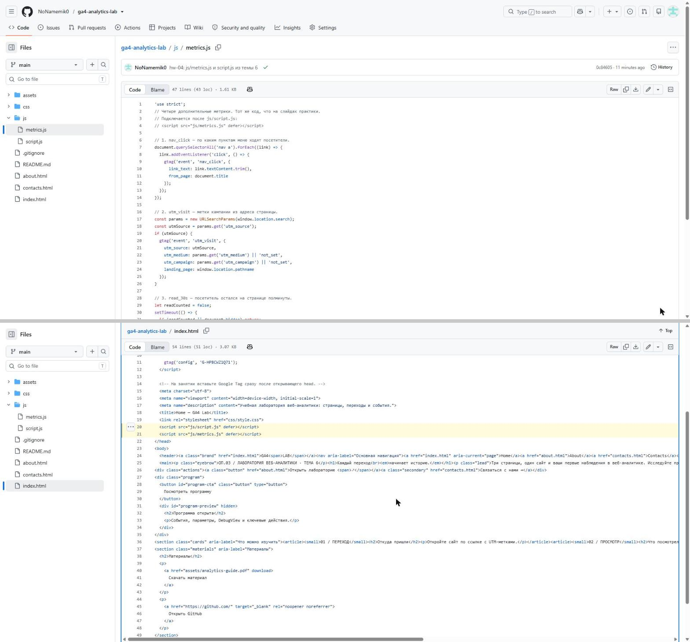
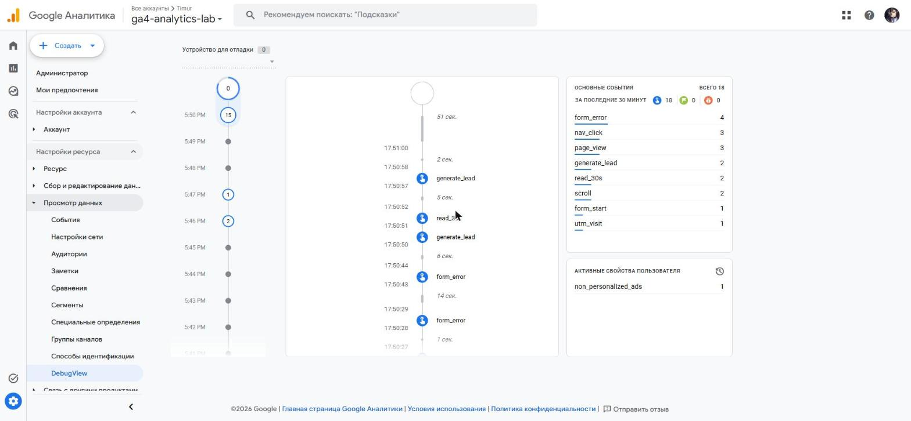
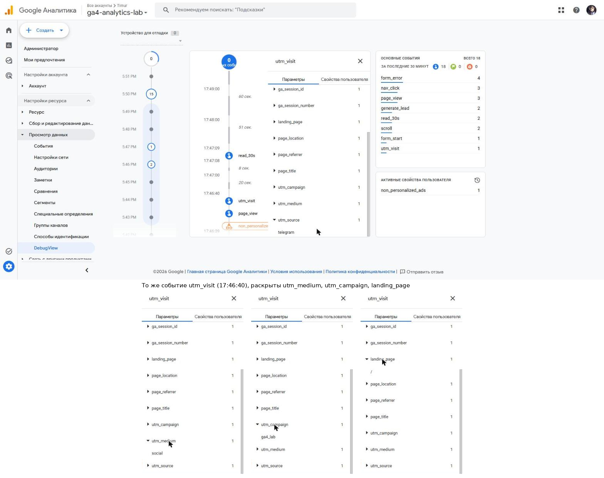
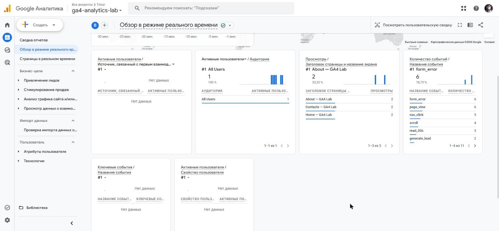

# Домашняя работа № 4 · Свои события и параметры в GA4

**Дисциплина:** ОП.03 «Информационные технологии»

| Поле | Значение |
|---|---|
| Фамилия, имя, отчество | Коковашин Тимур Александрович |
| Группа | 11/1-РПО-26/1 |
| Номер работы | 4 |
| Тема работы | Свои события и параметры: четыре метрики на сайте |
| Дата сдачи | 09.11.2026 |

---

## 1. Мой сайт и мой ресурс

| Поле | Значение |
|---|---|
| Публичный адрес сайта | https://ga4-analytics-lab.vercel.app |
| Measurement ID (`G-…`) | G-HPBCWZ1Q71 |
| Коммит с метриками (ссылка или первые 7 символов) | de135d3 (подключение), 0c84605 (файл metrics.js) |
| Статус публикации | READY |
| Страницы, где подключён `js/metrics.js` | index.html, about.html, contacts.html |

Файл подключается после основного скрипта и на каждой странице по одному
разу: два подключения дают двойные события.

## 2. Какие метрики добавлены

| Событие | Что измеряет | Что делали, чтобы оно сработало |
|---|---|---|
| `nav_click` | клики по пунктам меню | переходил по меню Home → About → Contacts |
| `utm_visit` | метки кампании из адреса | открывал сайт по ссылке с utm_source, utm_medium, utm_campaign |
| `read_30s` | полминуты на странице | оставался на главной 30 секунд, не сворачивая вкладку |
| `form_error` | форма не прошла проверку браузера | нажимал «Отправить заявку» с пустыми обязательными полями |



## 3. События в DebugView

| Поле | Значение |
|---|---|
| Дата и время проверки | 09.11.2026, 17:46–17:51 (МСК) |
| Как подключали отладку | Tag Assistant |
| Какие из четырёх событий пришли | все четыре: nav_click, utm_visit, read_30s, form_error |
| Какие не пришли и почему | — |



## 4. Параметры события `utm_visit`

**Ссылка, по которой открывали сайт:**

```
https://ga4-analytics-lab.vercel.app/?utm_source=telegram&utm_medium=social&utm_campaign=ga4_lab
```

| Параметр | Значение в ссылке | Значение в GA4 |
|---|---|---|
| `utm_source` | telegram | telegram |
| `utm_medium` | social | social |
| `utm_campaign` | ga4_lab | ga4_lab |
| `landing_page` | — | / |

В DebugView параметры раскрываются по одному, поэтому на кадре снизу добавлены ещё три состояния того же события.



Если значение в GA4 отличается от значения в ссылке, напишите, в чём разница
и почему так вышло.

>

## 5. Событие вне отладки

| Поле | Значение |
|---|---|
| Где проверяли | Realtime |
| Какое событие искали | form_error, nav_click, read_30s |
| Сколько срабатываний показал экран | form_error — 6, nav_click — 5, read_30s — 3 (за 30 минут) |
| Период (для отчёта) | — (Realtime, последние 30 минут) |



## 6. Что эти метрики показывают про сайт

Два-три предложения: что вы узнали о поведении посетителей из четырёх
новых событий. Например, по каким пунктам меню ходят чаще, доходит ли
кто-то до получаса чтения, спотыкается ли форма.

> Пока на сайте были только мои проверочные визиты, поэтому выводы предварительные. По меню переходили на About и Contacts, полминуты на странице досиживали не на каждой странице (read_30s — 3 раза при 6 просмотрах). Форма чаще не проходила проверку, чем отправлялась: form_error сработал 6 раз, generate_lead — 2, то есть посетитель спотыкается о пустые обязательные поля.

## 7. Что не получилось

Если какая-то метрика не заработала, напишите какая, что показывал экран
и что было проверено по таблице из `README.md`. Незаполненный раздел
означает, что всё получилось.

>

## 8. Использование ИИ

Скрипты метрик выданы готовыми. Подключение, проверку и кадры вы делаете
сами. ИИ допускается для формулировок и оформления.

| Вопрос | Ответ |
|---|---|
| Что сделано самостоятельно |  |
| Что спрошено у модели |  |
| Что после этого изменено |  |
